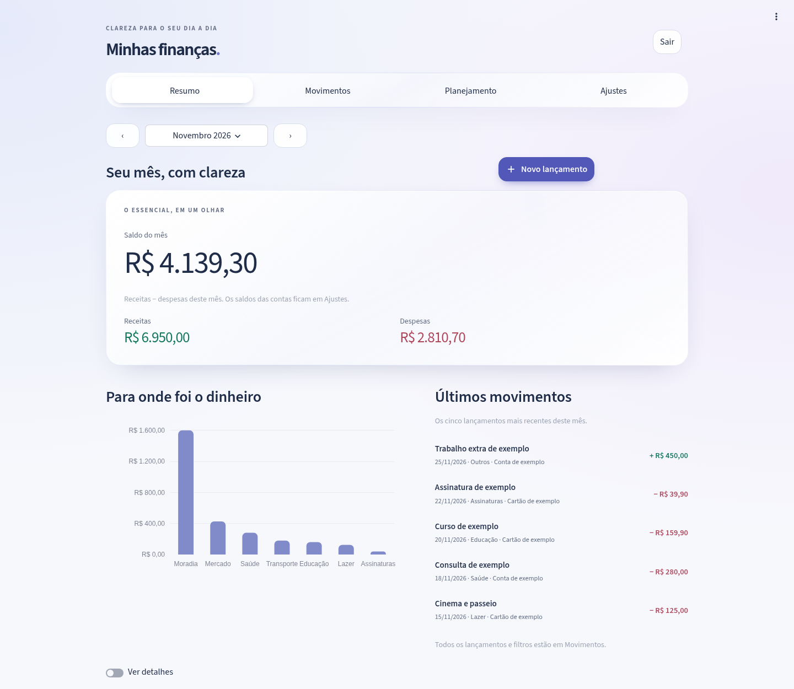

# Minhas finanças

Aplicativo de controle financeiro pessoal em português, executado no seu computador com **Python 3.11+, Streamlit e SQLite**. Registre receitas e despesas, acompanhe orçamento e metas, importe extratos e visualize seu histórico mensal e anual.



[Ver prévia em tela de 360 px](docs/liquid-glass-mobile.png). As imagens usam somente dados de demonstração.

## Instalação e primeira execução no Windows

Abra o projeto no VS Code e use **Terminal → Novo Terminal** (PowerShell), na pasta que contém `app.py`. É necessário Python 3.11 ou superior:

```powershell
py --version
py -m venv .venv
.\.venv\Scripts\python.exe -m pip install -r requirements.txt
.\.venv\Scripts\python.exe scripts\configurar_senha.py
```

O último comando pede uma senha de pelo menos 12 caracteres e sua confirmação no próprio terminal, sem exibi-la. O limite é 72 bytes em UTF-8; caracteres acentuados podem ocupar mais de um byte. Ele grava somente o hash bcrypt em `.streamlit/secrets.toml`, na seção `[auth]`, chave `password_hash`. Não coloque a senha em comandos, argumentos, código, Git ou mensagens. Guarde-a no seu gerenciador de senhas. O arquivo de segredos fica fora do Git.

Valide a configuração e inicie:

```powershell
.\.venv\Scripts\python.exe -m services.auth --check
.\run_mobile.bat
```

O script usa a `.venv` sem exigir ativação no PowerShell, entra na pasta correta, mostra os endereços disponíveis e inicia o aplicativo. No próprio PC, abra `http://127.0.0.1:8501`. Informe a senha na tela de login. Nenhuma página financeira ou exportação fica disponível antes da autenticação; hash ausente ou inválido bloqueia o acesso. Use **Sair** para encerrar a sessão naquele navegador. A sessão expira após 30 minutos sem interação e exige novo login; a verificação ocorre na próxima interação. Cinco tentativas incorretas em um minuto provocam espera temporária, compartilhada entre os navegadores conectados ao mesmo processo.

Para encerrar a execução manual, pressione `Ctrl+C`. As tabelas e categorias padrão são criadas automaticamente na primeira execução autenticada. A instalação das bibliotecas precisa de internet; o aplicativo não envia dados financeiros a serviços externos.

A configuração de rede agora escuta em `0.0.0.0`, porta fixa `8501`, com `headless=true` e telemetria desativada. Isso permite conexões de outras máquinas: **configure o Firewall antes do uso em rede**. `0.0.0.0` é o endereço de escuta, não um endereço para digitar no celular.

### Linux/macOS e execução direta

Com Python 3.11+ e o terminal na raiz:

```bash
python -m venv .venv
source .venv/bin/activate
pip install -r requirements.txt
python scripts/configurar_senha.py
python -m services.launcher
```

O comando `streamlit run app.py` continua disponível. O launcher é recomendado para executar a verificação e o backup antes de o servidor aceitar conexões. Na execução direta do Streamlit, o código do app só inicia quando um navegador estabelece uma sessão; o backup ocorre após o primeiro login válido, antes de alterar o banco.

### Atualizar uma instalação existente

Encerre o app e preserve `data/`, `.streamlit/secrets.toml` e sua `.venv`. Se clonou com Git, execute `git pull origin main` na pasta do projeto. Se baixou um ZIP, copie os arquivos de código novos para a pasta atual, incluindo `ui/styles.css`, sem apagar os dados ou a configuração da senha. Este redesign não altera o esquema do banco nem exige trocar a senha. Inicie novamente com `run_mobile.bat`, atualize a página com `Ctrl+F5` e faça login.

## Interface e primeiros passos

A navegação foi organizada em quatro áreas, com controles nativos horizontais que se adaptam à largura disponível. No celular, ela permanece no fluxo da página para não cobrir formulários ou o teclado.

| Área | Onde encontrar cada recurso |
| --- | --- |
| **Resumo** | Saldo do mês, receitas, despesas, gastos por categoria e os cinco últimos lançamentos. **Ver detalhes** abre comparação mensal, evolução diária, maiores despesas e histórico anual. |
| **Movimentos** | Lançamentos, busca e filtros sob demanda; na seção **Importar e exportar**, prévia CSV/OFX e downloads CSV/Excel. |
| **Planejamento** | Orçamento, recorrências e metas com seus respectivos cadastros e ajustes. |
| **Ajustes** | Contas e cartões, categorias e informações de segurança/configuração disponíveis. |

1. Em **Ajustes → Contas e cartões**, escolha **Adicionar conta/cartão** no controle **Gerenciar contas e cartões**, preencha o cadastro e informe seu saldo inicial.
2. No **Resumo** ou em **Movimentos → Lançamentos**, clique em **+ Novo lançamento**. O cadastro abre em uma janela; preencha data, descrição, valor positivo, tipo, categoria e conta. O tipo determina se o valor entra ou sai. **Cancelar** fecha a janela sem gravar.
3. Use as setas ao lado da competência para avançar ou voltar um mês. Clique no nome do mês/ano para selecionar diretamente a competência. Um novo lançamento começa com a data de hoje no mês atual ou com o primeiro dia de outro mês escolhido.
4. Em **Movimentos → Lançamentos**, use **Gerenciar lançamentos** para selecionar um registro e abrir **Editar lançamento**. A exclusão exige confirmação explícita e fica na janela de edição.
5. Em **Planejamento → Orçamento**, defina limites mensais por categoria. A partir de 80% há aviso textual; a partir de 100%, o limite foi atingido ou ultrapassado. Os valores gasto, limite e restante ficam visíveis sem barras grandes.
6. Abra **Planejamento → Recorrências/Metas** para acompanhar obrigações e reservas. Escolha a ação desejada no seletor de gerenciamento para abrir um formulário por vez; **Fechar formulário** recolhe esse formulário. As opções de cadastro, edição, exclusão e aportes foram preservadas.

### Visual inspirado em Liquid Glass

O tema claro usa fundo com degradês discretos, tipografia de alto contraste e transparência concentrada na navegação, no saldo em destaque e nas janelas. As listas e os formulários ficam sobre superfícies de leitura limpa. O visual é uma adaptação para Streamlit, não uma reprodução de todas as interações nativas do iOS.

Os estilos são locais e centralizados em `ui/styles.css`; não há fontes, imagens, scripts ou CDNs externos. Navegadores sem suporte a desfoque recebem fundos sólidos de fallback. As transições são breves e respeitam a preferência de movimento reduzido do sistema. A navegação mantém rótulos, foco visível e controles nativos para teclado/leitores de tela.

Valores aceitam `1234,56`, `1.234,56` e `1234.56`. O aplicativo não arredonda entradas com mais de duas casas decimais. Valores são exibidos como `R$ 1.234,56`; datas, como `dd/mm/aaaa`.

Categorias padrão: Moradia, Mercado, Transporte, Lazer, Saúde, Educação, Assinaturas e Outros. Categorias e contas em uso não podem ser excluídas: altere ou remova os registros vinculados antes. A exclusão de um lançamento é definitiva; mantenha backups.

### Saldos e cartões

O saldo de uma conta é o saldo inicial mais todas as receitas menos todas as despesas registradas nela. Ele considera também lançamentos futuros cadastrados. O saldo mensal do dashboard é apenas receitas menos despesas daquele mês, sem o saldo inicial.

Cartões usam o mesmo registro de movimentos: compras são despesas integrais na data da compra; saldo negativo representa dívida. Este MVP **não gerencia faturas, fechamento, vencimento, parcelamento ou transferências entre contas**. Não duplique uma compra como outra despesa ao registrar um pagamento, pois isso duplicaria o gasto nos relatórios. Para manter a análise de gastos do cartão, registre as compras nele; uma conciliação de pagamentos entre contas exigirá uma evolução específica do modelo.

### Recorrências

Crie uma regra mensal com dia, mês inicial, mês final opcional, conta e categoria. Ao abrir ou atualizar o aplicativo, as competências pendentes com data já alcançada são geradas automaticamente sem repetir uma mesma regra no mesmo mês. Dias 29, 30 e 31 são ajustados ao último dia de meses mais curtos. A regra pode ser desativada para suspender novas gerações; ao reativá-la, os meses pendentes durante a pausa também são recuperados. Para encerrar uma obrigação, defina o mês final. Editar a regra não altera o histórico já gerado. Excluir um lançamento gerado não faz com que ele reapareça.

O aplicativo não é um agendador em segundo plano: se ficar fechado, a recuperação dos meses pendentes ocorre na próxima abertura. Revise o mês inicial antes de salvar uma regra retroativa.

### Metas

Uma meta tem nome, valor-alvo e prazo. O progresso é a soma dos **aportes registrados manualmente**. Aportes são anotações para acompanhamento: não criam lançamentos, não movimentam contas e não reservam saldo automaticamente. Registre eventual movimento financeiro também na conta correspondente, conforme seu controle.

## Importação e exportação

A importação CSV permite escolher codificação (UTF-8 ou Latin-1), separador (ponto e vírgula, vírgula, tabulação ou barra vertical), formato de data e as colunas de data, descrição e valor. Tipo e observação são opcionais. Escolha a conta e a categoria que receberão os movimentos; depois poderá editar os lançamentos individualmente.

No modo de tipo automático, valores negativos são despesas e positivos são receitas. Com tipo fixo, o valor representa o montante do lançamento. Datas brasileiras e ISO são suportadas conforme o formato escolhido. OFX simples também é aceito: são lidos os movimentos, valores, datas, nomes e observações, sem conectar ao banco.

Confira a prévia antes de salvar. Linhas inválidas bloqueiam a importação inteira. São consideradas possíveis duplicatas as linhas com mesma data, descrição normalizada, valor, tipo e conta, tanto no banco quanto no próprio arquivo; categoria e observação não diferenciam esses movimentos. Por padrão, duplicatas são puladas. Só permita sua inclusão quando tiver confirmado que representam movimentos distintos.

As exportações contêm todas as tabelas: **CSV em um arquivo ZIP**, com um CSV por tabela, ou **Excel**, com uma aba por tabela. Datas saem em `dd/mm/aaaa`; valores monetários em reais com vírgula decimal, preservados como texto para não perder centavos. Textos potencialmente interpretados como fórmulas por planilhas são protegidos. A exportação serve para consulta. O backup automático usa o próprio SQLite; para restauração, siga a seção de backups abaixo. Na exportação Excel, caracteres de controle incompatíveis com XML são substituídos por `�`; banco e CSV preservam o texto original.

## Demonstração opcional

Para experimentar sem misturar dados reais:

```bash
python seed.py
```

Isso cria `data/demo.db` com três meses de movimentos fictícios, duas contas, orçamentos, uma recorrência para o próximo mês e uma meta. Repetir o comando não duplica os dados. O script ignora `FINANCAS_DB_PATH` e só usa `--db` quando informado explicitamente; recusa um banco existente que não tenha sido criado como demonstração.

Abra a base demonstrativa no Linux/macOS:

```bash
FINANCAS_DB_PATH=data/demo.db python -m services.launcher
```

No Windows PowerShell:

```powershell
$env:FINANCAS_DB_PATH = "data/demo.db"
.\.venv\Scripts\python.exe -m services.launcher
```

Para voltar à base pessoal, encerre o app e remova a variável (`unset FINANCAS_DB_PATH` no Linux/macOS ou `Remove-Item Env:FINANCAS_DB_PATH` no PowerShell). Também é possível criar outra demonstração: `python seed.py --db data/outra-demo.db`.

## Dados, privacidade e backup

- O banco padrão é `data/financas.db`, relativo à pasta do projeto. Para escolher outro, defina `FINANCAS_DB_PATH` antes de iniciar o app.
- Os cálculos usam centavos inteiros; conversões monetárias usam `Decimal`. O SQLite mantém tudo em um arquivo e ativa integridade referencial.
- As migrações são executadas automaticamente na inicialização e controladas por `PRAGMA user_version`. Antes de atualizar o projeto, encerre o app e copie o banco para um local seguro. Para restaurar, encerre o app e substitua o arquivo por sua cópia.
- O app não faz chamadas a APIs, não carrega fontes ou imagens remotas e desativa a telemetria do Streamlit em `.streamlit/config.toml`. Arquivos importados são processados no processo local; gráficos também são renderizados localmente.
- O login por senha protege o acesso pelo aplicativo; ele não criptografa o banco nem os backups. Use a proteção de acesso e a criptografia de disco do Windows. Não compartilhe a pasta de dados ou de segredos.
- Bancos, backups, logs, CSV, OFX, planilhas, arquivos `.env` e `.streamlit/secrets.toml` são ignorados pelo Git. Isso não remove arquivos que já tenham sido versionados anteriormente; confira `git status` antes de publicar alterações.

### Backup automático e restauração

Ao iniciar pelo `run_mobile.bat` ou `python -m services.launcher`, o aplicativo faz uma cópia consistente do banco existente usando `sqlite3.Connection.backup()`, antes das migrações e da geração de recorrências. A primeira execução sem banco ainda não tem dados para copiar. Depois que ele for criado, a próxima verificação — em nova inicialização ou interação autenticada — cria a primeira cópia. Na execução direta do Streamlit, a verificação começa após o login válido, antes de alterar o banco.

As cópias ficam na pasta `backups/` ao lado do banco de origem: para `data/financas.db`, em `data/backups/`. São mantidas as **sete cópias mais recentes de cada banco**, sem misturar a retenção da demonstração com a da base pessoal. Depois da primeira cópia bem-sucedida, interações e atualizações de páginas não criam novos backups no mesmo processo. Uma falha de backup impede a inicialização com alterações no banco; consulte o log e resolva o problema.

Para restaurar:

1. Encerre o app e pare temporariamente sua tarefa no Agendador, se estiver ativa.
2. Guarde uma cópia separada do banco atual antes de substituí-lo.
3. Copie o backup escolhido para o caminho do banco original, por exemplo `data/financas.db`.
4. Inicie o aplicativo e confira os lançamentos. A cópia de segurança contém os dados até o momento em que foi criada.

Os backups no mesmo disco ajudam a recuperar alterações acidentais, mas não protegem contra perda desse disco. Guarde cópias adicionais em um local privado de sua escolha.

## Acesso pelo celular com Tailscale

O PC hospeda o aplicativo; o celular usa apenas o navegador. O PC precisa estar ligado, com o aplicativo ativo e sem suspensão. **Não ative Tailscale Funnel, não encaminhe portas no roteador e não use ngrok ou hospedagem pública.**

### 1. Instale e conecte o Tailscale

Instale o Tailscale no Windows e no celular, entre na mesma conta/rede Tailscale e deixe a VPN conectada nos dois. No PC, abra um novo terminal depois da instalação:

```powershell
tailscale status
tailscale ip -4
```

O segundo comando informa o IPv4 privado do PC, normalmente `100.x.x.x`. Caso o executável não esteja no PATH, abra novamente o terminal ou execute o Tailscale instalado em `C:\Program Files\Tailscale\tailscale.exe`. O script de inicialização tenta localizar esse executável; se não encontrar, avisa e continua disponível para uso local/LAN.

### 2. Configure o Firewall do Windows

O script **altera o Firewall e exige PowerShell como administrador**. Ele só será executado por você. Primeiro veja o que seria feito:

```powershell
.\scripts\liberar_firewall.ps1 -WhatIf
```

Confira a explicação e, quando quiser aplicar:

```powershell
.\scripts\liberar_firewall.ps1
```

A regra `MinhasFinancas-Mobile-8501` permite entrada TCP na porta `8501` somente no perfil **Privado**, limitada às sub-redes LAN IPv4 privadas detectadas (interfaces com gateway e perfil Privado) e à faixa Tailscale `100.64.0.0/10`. Ela não abre portas no roteador, não publica o app na internet e não altera automaticamente o perfil de nenhuma rede. Confirme que a LAN é uma rede confiável antes de classificá-la como Privada.

Antes de criar a regra, o script consulta a política efetiva (`ActiveStore`): os perfis Domain, Private e Public precisam estar habilitados e com entrada padrão `Block`. Se encontrar Firewall desativado, `Allow`, `NotConfigured` ou estado indeterminado, ele interrompe sem alterar regras. Uma permissão restrita não protege o servidor quando o restante do tráfego não está bloqueado. Revise a política com o administrador/TI; o script não habilita o Firewall nem muda políticas automaticamente.

O adaptador Tailscale pode aparecer como **Público** no Windows. Nesse caso, a regra somente Privada pode não atender à conexão pela VPN. O script avisa, mas não modifica perfis. Primeiro consulte **somente os perfis Tailscale**, sem fazer alterações:

```powershell
Get-NetConnectionProfile |
    Where-Object { $_.InterfaceAlias -match 'Tailscale' } |
    Format-Table InterfaceAlias, InterfaceIndex, NetworkCategory
```

Se aparecer o adaptador VPN correto com `NetworkCategory` igual a `Public`, você pode classificá-lo como Privado **somente depois de confirmar que é o adaptador Tailscale confiável**. Essa é uma alteração de rede do Windows e exige PowerShell como administrador. Digite o `InterfaceIndex` exibido acima; não use um número copiado de outro computador:

```powershell
$indiceTailscale = [int](Read-Host 'InterfaceIndex confirmado do adaptador Tailscale')
$perfilTailscale = Get-NetConnectionProfile -InterfaceIndex $indiceTailscale
$perfilTailscale | Format-Table InterfaceAlias, InterfaceIndex, NetworkCategory
if ($perfilTailscale.InterfaceAlias -notmatch 'Tailscale') {
    throw 'O perfil escolhido nao e Tailscale. Nenhuma alteracao foi feita.'
}
Set-NetConnectionProfile -InterfaceIndex $indiceTailscale -NetworkCategory Private -WhatIf
```

Confira o adaptador e a simulação. Apenas se desejar aplicar a mudança nesse adaptador, execute e confirme:

```powershell
Set-NetConnectionProfile -InterfaceIndex $indiceTailscale -NetworkCategory Private -Confirm
```

Isso altera apenas o perfil identificado pelo índice. **Não reclassifique Wi-Fi público, rede de hotel ou adaptadores desconhecidos como Privados.** Se o perfil Tailscale não aparecer, o nome for diferente, ou a empresa impedir a alteração, pare e confirme a configuração com o Tailscale/TI; não libere a porta para todo o perfil Público como alternativa. Depois da configuração deliberada, revise a regra e teste novamente o acesso VPN.

Regras amplas de Python/Streamlit já existentes podem permitir mais acesso que a regra criada: revise as regras apontadas pelo script em **Firewall do Windows com Segurança Avançada**.

Se o endereço/sub-rede da LAN mudar, execute novamente o script e confira o escopo. Para remover **somente a regra criada pelo projeto**, use PowerShell como administrador, revise e depois aplique:

```powershell
Remove-NetFirewallRule -Name 'MinhasFinancas-Mobile-8501' -WhatIf
Remove-NetFirewallRule -Name 'MinhasFinancas-Mobile-8501' -Confirm
```

A remoção da regra não encerra o servidor nem remove outras permissões existentes. Para desativar o acesso, encerre o app e revise possíveis regras mais amplas que já existiam.

### 3. Suba o app e abra no celular

No terminal normal, na pasta do projeto:

```powershell
.\run_mobile.bat
```

O terminal mostra links como `http://100.x.x.x:8501` (Tailscale) e `http://192.168.x.x:8501` (LAN). Digite no navegador do celular o endereço Tailscale completo, incluindo `http://` e `:8501`, e informe a senha do app. Estar na mesma conta Tailscale é necessário, mas as regras de acesso da sua rede Tailscale também precisam permitir a conexão ao PC.

Pela VPN, o tráfego HTTP viaja dentro do túnel criptografado do Tailscale. O endereço LAN usa HTTP diretamente: utilize-o apenas em rede local confiável. A senha do app não substitui o isolamento da rede e do Firewall.

### 4. Instale a inicialização automática

A tarefa inicia **no logon do seu usuário**, depois que você entra no Windows. Ela não executa antes da tela de login do Windows. Confira a operação antes:

```powershell
.\scripts\instalar_autostart.ps1 -WhatIf
.\scripts\instalar_autostart.ps1
```

O script cria a tarefa `MinhasFinancas-Mobile`, tenta usar permissões comuns e informa se a política do Windows exigir elevação. Se for necessário executar como administrador, use a mesma conta Windows. Ele não pede nem salva a senha da sua conta Windows. O aplicativo inicia em janela oculta e o Agendador tenta reiniciá-lo a cada minuto, até três vezes, quando há falha. Nenhum instalador do projeto é executado automaticamente.

Não mantenha uma execução manual e a tarefa usando a mesma porta ao mesmo tempo. Para testar, encerre o terminal manual, saia e entre novamente na sua conta Windows e abra o aplicativo no celular. Confira a tarefa no **Agendador de Tarefas** e os registros em `logs/app.log`.

Para remover a inicialização automática (o app que já estiver rodando não será encerrado pelo script):

```powershell
.\scripts\remover_autostart.ps1 -WhatIf
.\scripts\remover_autostart.ps1
```

### 5. Use o nome do computador (MagicDNS)

Se o MagicDNS estiver habilitado na sua rede Tailscale, use `http://NOME-DO-PC:8501` ou o nome DNS completo mostrado no Tailscale, em vez do IP. Não use o nome de outro dispositivo: o endereço deve apontar para o PC em que o app está rodando. Se o nome não resolver, teste o IP retornado por `tailscale ip -4` e confira MagicDNS nas configurações do Tailscale.

### 6. Mantenha o PC acordado

No Windows, abra **Configurações → Sistema → Energia e bateria → Tela e suspensão** (os nomes variam por versão). Para o período **conectado à tomada**, configure a suspensão como **Nunca** enquanto precisar do acesso. A tela pode desligar normalmente. Confira também o comportamento ao fechar a tampa de um notebook; fechar a tampa pode suspender o computador. Os scripts não mudam essas opções.

### Logs e solução de problemas

O `run_mobile.bat` registra inicialização e saída do servidor em `logs/app.log`. Na inicialização, se o arquivo tiver pelo menos 5 MB, ele é rotacionado: são mantidos até quatro históricos (`app.log.1` a `app.log.4`). A rotação não ocorre durante a execução contínua; confira o espaço em disco se o app ficar ligado por muito tempo. Não inclua senhas ou dados financeiros em mensagens de log. Logs e backups ficam fora do Git.

| Sintoma | O que conferir |
| --- | --- |
| Não abre fora de casa | VPN conectada no celular e PC, PC ligado, app ativo e endereço Tailscale correto. |
| Abre no PC, mas não no celular | Regra de Firewall, perfil do adaptador e políticas de acesso da rede Tailscale. |
| Sem VPN abre no Wi-Fi de casa | É esperado: o acesso LAN foi permitido. O teste de bloqueio deve ocorrer fora dessa LAN. |
| Deixou de responder após algum tempo | Suspensão do PC, tampa do notebook, logoff ou encerramento da tarefa. |
| Porta 8501 ocupada | Pode haver uma execução manual ou tarefa já ativa. Pare a instância conhecida antes de iniciar outra; não encerre processos desconhecidos. |
| Tailscale não encontrado | Instalação, novo terminal para atualizar PATH, serviço Tailscale e caminho do executável. |
| Login bloqueado por configuração | Execute `scripts/configurar_senha.py` e `python -m services.auth --check`; reinicie o app após alterar o segredo. |
| PowerShell bloqueou o script | Confira as políticas da empresa/Windows e solicite orientação da TI. Não altere a política de execução da máquina para contornar uma restrição corporativa. |
| Tarefa falhando | Caminho do projeto/`.venv`, senha configurada, acesso ao banco/backups e `logs/app.log`. |
| Alterei o IP da LAN | Use o IP novo exibido e revise novamente o escopo da regra de Firewall. |

## Testes e verificação manual

Execute:

```bash
python -m pytest -q
```

Os testes usam bancos temporários e cobrem valores, saldos, orçamento, recorrências, importação, demonstração, login, backups e detecção de IPs. Não precisam do seu banco pessoal. Testes automatizados não substituem a verificação real do Firewall, do Agendador e do acesso pelo celular no Windows.

Roteiro rápido na base de demonstração:

1. No **Resumo**, confira os três valores do mês, o gráfico por categoria e os cinco últimos lançamentos. Ative **Ver detalhes** para conferir evolução diária, comparação mensal, maiores despesas e histórico anual.
2. Use **+ Novo lançamento** para cadastrar uma despesa de `10,50`; confirme que o saldo da conta diminui exatamente esse valor. Em **Movimentos → Lançamentos → Gerenciar lançamentos**, edite para `12,50` e depois exclua com confirmação para conferir a reversão.
3. Em **Planejamento → Orçamento**, confira os três estados: Moradia abaixo de 80%, Mercado acima de 80% e Lazer acima do limite. O estado é comunicado por texto, além da cor.
4. Em **Planejamento → Recorrências**, crie uma regra com início no mês atual e dia 1, atualize a página duas vezes e confira que existe somente um lançamento daquela competência.
5. Em **Planejamento → Metas**, registre um aporte e confira o progresso, alvo e prazo; o saldo da conta deve permanecer igual.
6. Em **Movimentos → Importar e exportar**, importe um pequeno extrato com prévia e depois o mesmo arquivo novamente para conferir a detecção de duplicatas.
7. Na mesma seção, prepare os downloads CSV/Excel e confira moeda, datas e registros. Cancele uma janela de cadastro e confira que nenhum lançamento foi salvo.

### Checklist manual do visual e dos formulários

- [ ] Abrir em desktop e em tela de aproximadamente 360 px, confirmar que não há rolagem horizontal na página e que textos/valores longos continuam legíveis.
- [ ] Navegar pelas quatro áreas e suas subseções sem perder a competência selecionada; testar dezembro → janeiro e a volta.
- [ ] Abrir **+ Novo lançamento**, preencher um rascunho e cancelar. Reabrir e confirmar que nada foi gravado nem reaproveitado indevidamente.
- [ ] Cadastrar, editar e excluir um lançamento com confirmação; conferir os valores exatos nos saldos e no Resumo.
- [ ] Ativar/desativar **Ver detalhes** e verificar que os relatórios adicionais aparecem somente quando pedidos.
- [ ] Usar Tab/Shift+Tab para verificar foco visível e acesso a menus, seletor de competência, botões e formulários.
- [ ] Ativar movimento reduzido no sistema e conferir que as transições são removidas. O conteúdo deve continuar utilizável sem suporte a desfoque.
- [ ] No celular, abrir o teclado dentro do diálogo e verificar que o formulário e as ações continuam alcançáveis por rolagem.

### Checklist manual de rede e inicialização

- [ ] No PC, abrir o app, conferir que nenhuma página financeira aparece antes do login e que senha incorreta é recusada.
- [ ] Entrar com a senha correta, conferir as páginas e exportações, clicar em **Sair** e verificar o bloqueio novamente.
- [ ] No celular conectado ao mesmo Wi-Fi, abrir o endereço LAN e conferir o login.
- [ ] No celular, **desligar o Wi-Fi**, usar dados móveis e ligar Tailscale. Abrir o IP Tailscale/MagicDNS do PC e conferir o login.
- [ ] Ainda com Wi-Fi desligado e dados móveis, **desligar o Tailscale** e tentar recarregar/abrir uma nova aba. O app não deve carregar. Uma tela já desenhada pode continuar visível sem estar conectada.
- [ ] Religar o Tailscale e confirmar que o acesso volta. Não testar o bloqueio na LAN, onde o acesso sem VPN foi permitido.
- [ ] Encerrar o app, iniciá-lo novamente e conferir uma nova cópia do banco em `data/backups/`; interagir com páginas não deve gerar novas cópias no mesmo processo.
- [ ] Instalar o autostart, encerrar a instância manual, sair/entrar no Windows e conferir o app pelo celular e `logs/app.log`.
- [ ] Remover a tarefa com o script e conferir que não volta no próximo logon. Reinstalar quando desejar.

## VS Code

Abra a pasta do projeto no VS Code e instale as extensões Python e Python Debugger sugeridas. Selecione o interpretador de `.venv`. Em **Executar e Depurar**, escolha **Finanças: executar e depurar (somente PC)**; os breakpoints funcionam nas páginas e serviços Python. **Finanças: demonstração** usa `data/demo.db` (execute `python seed.py` antes). **Finanças: celular (LAN/Tailscale)** inicia o launcher com a configuração de rede do projeto. Configure senha e Firewall antes. Os testes aparecem no painel de testes via pytest.

## Estrutura e arquitetura

```text
app.py                 Login, inicialização e navegação Streamlit
database/              Conexão SQLite, esquema e migrações
services/              Regras, validações, importação e relatórios
ui/                    Páginas, navegação compacta e estilos locais
tests/                 Testes automatizados com bancos temporários
scripts/               Configuração da senha, Firewall e Agendador
run_mobile.bat/.ps1     Inicialização Windows, endereços e logs
seed.py                Demonstração opcional e isolada
data/                  Bancos locais, fora do Git
.streamlit/            Tema, porta 8501, rede privada e segredo local
.vscode/               Configurações de execução e depuração
CLAUDE.md              Convenções para manutenção
```

As páginas chamam serviços; regras financeiras não ficam em callbacks da interface. Os serviços validam entradas e consultam/persistem dados em SQLite. Plotly apresenta os gráficos; a exportação Excel usa openpyxl. Pandas está disponível para análises locais. Erros de validação são mostrados em português.
